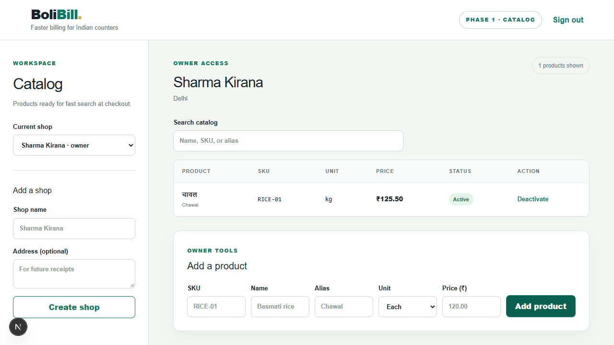

# BoliBill

**BoliBill** is a working name for a local-first, voice-assisted billing system for Indian retail counters. The goal is faster checkout with English, Hindi, or Hinglish speech, an editable bill, exact server-side calculations, a shop-specific UPI QR, and a printable receipt. The AI will propose edits visually; it will never speak or decide totals or payment status.

**Current state: Phase 1 started.** A web catalog workspace, Fastify API, Better Auth sessions, owner/cashier shop membership, scoped catalog routes, Drizzle migrations, and local PostgreSQL are implemented. Billing, voice, QR payments, GST, and printing are later phases; the current UI does not claim to perform them. The [roadmap](docs/ROADMAP.md) and [implementation plan](docs/IMPLEMENTATION_PLAN.md) track remaining work.



## Run locally (Windows PowerShell)

Requirements: Node.js 24+, pnpm 11.25.0, and free disk space for the bundled PostgreSQL binary. No Docker, cloud account, paid API, or payment subscription is required. The PostgreSQL wrapper starts a real PostgreSQL 18 server on localhost; its package is currently marked beta.

```powershell
pnpm install
Copy-Item apps/api/.env.example apps/api/.env
$secret = [Convert]::ToHexString([Security.Cryptography.RandomNumberGenerator]::GetBytes(32))
(Get-Content apps/api/.env) -replace '^BETTER_AUTH_SECRET=.*$', "BETTER_AUTH_SECRET=$secret" | Set-Content apps/api/.env
```

Run these in separate terminals from the repository root:

```powershell
pnpm --filter @bolibill/api db:local
```

```powershell
pnpm db:migrate
pnpm dev
```

Open `http://127.0.0.1:3000`. Create an account and shop, then add products. For a cashier account, create a second account and use the owner-only `POST /api/shops/:shopId/memberships` endpoint with `{ "email": "cashier@example.com", "role": "cashier" }`. The account must already exist. The owner can read membership records at the same path with `GET`.

The API listens on `http://127.0.0.1:4000`; the web app uses that origin by default. To use other origins, set `API_ORIGIN` and `WEB_ORIGIN` in `apps/api/.env` and `NEXT_PUBLIC_API_ORIGIN` for the web build. Use a random `BETTER_AUTH_SECRET`; `.env` and database files are ignored by Git.

## Verify

With the local database running:

```powershell
pnpm check
pnpm test
pnpm build
```

The API integration test migrates its separate `bolibill_test` database and checks two-shop isolation, owner/cashier permissions, UTF-8 Hindi product storage, duplicate SKU handling, and rejected origins. The browser smoke test performed during Phase 1 covered account creation, shop creation, and a Hindi product at ₹125.50/kg. See [Phase 1 evidence](docs/evidence/PHASE1_FOUNDATION_2026-10-24.md).

## Phase 0 evidence

The [cashier workflow](docs/PHASE0_WORKFLOW.md), [evaluation protocol](evals/DATASET.md), and [five-clip ASR comparison](docs/evidence/VOICE_COMPARISON_2026-10-24.md) are available. That early public-speech probe did not establish cashier-domain accuracy or select a final model. The parser plan starts with deterministic number/unit rules and catalog matching; a small local model is added only if held-out cases show an accuracy benefit at acceptable latency. No paid AI service is required.

UPI QR generation in later phases will encode the shop's trusted merchant ID and exact amount. Scanning a QR is not payment verification; cashier confirmation must be explicitly recorded against the merchant's bank/UPI app.
